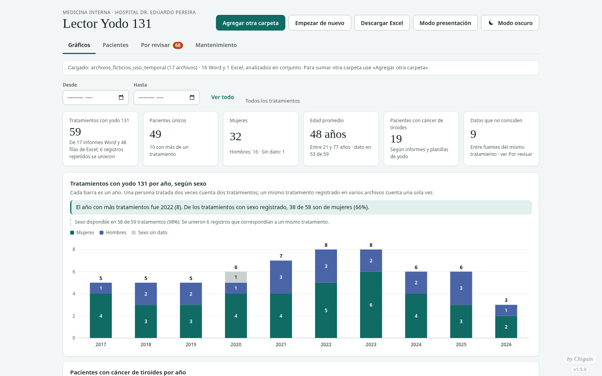
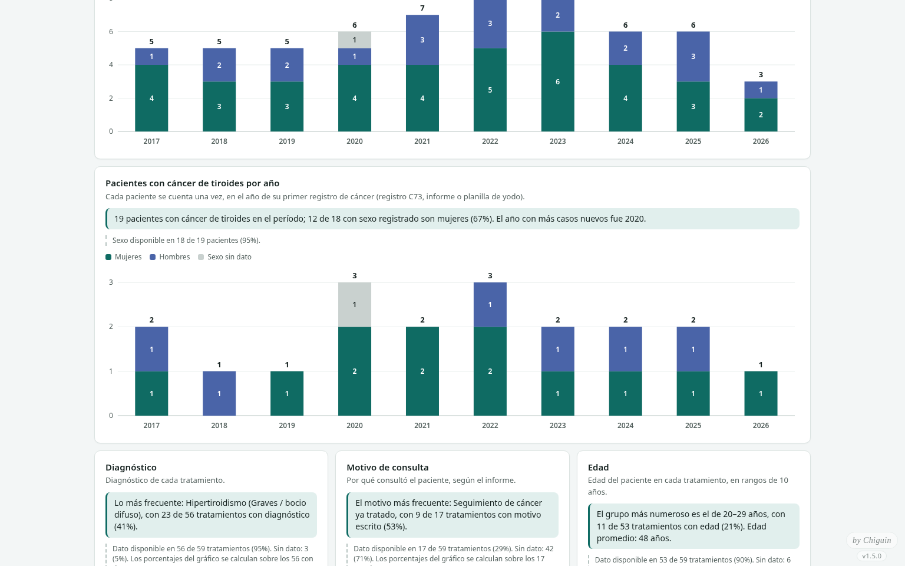
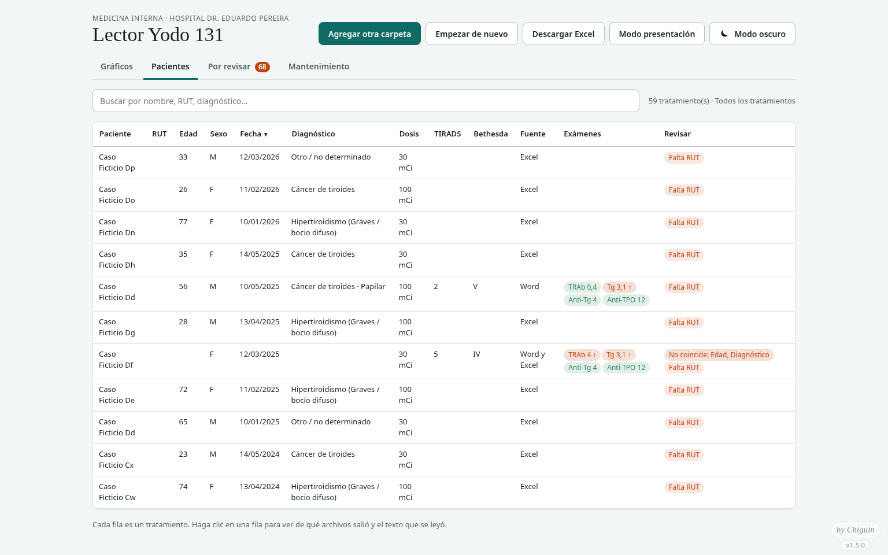
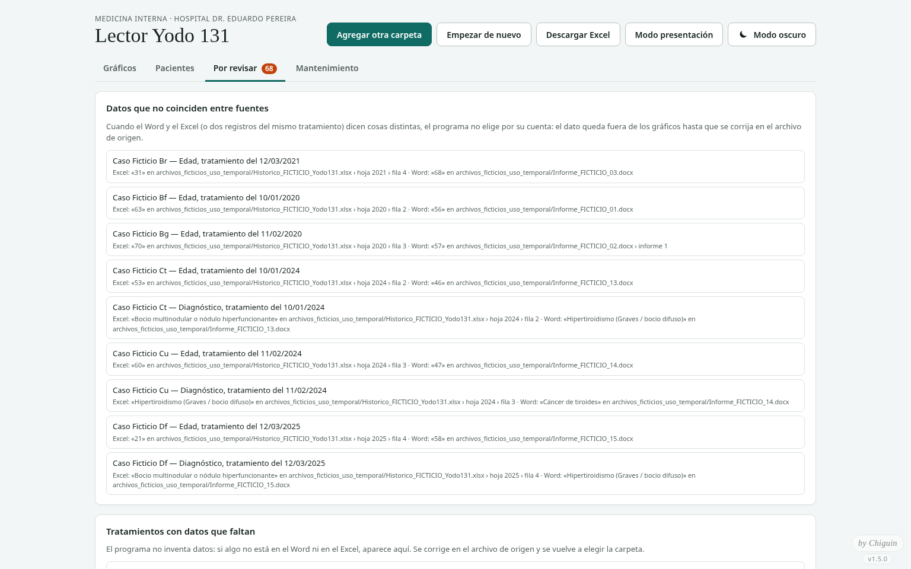
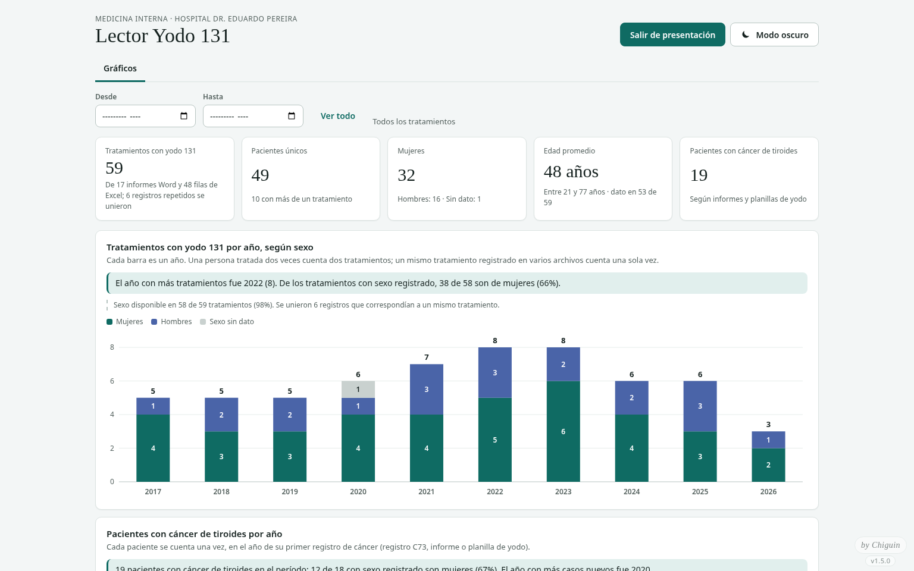
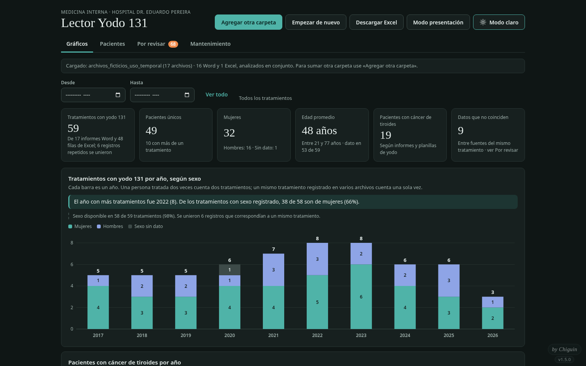
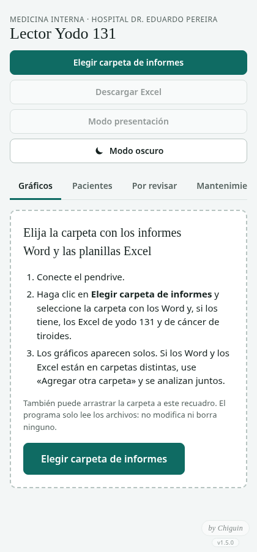
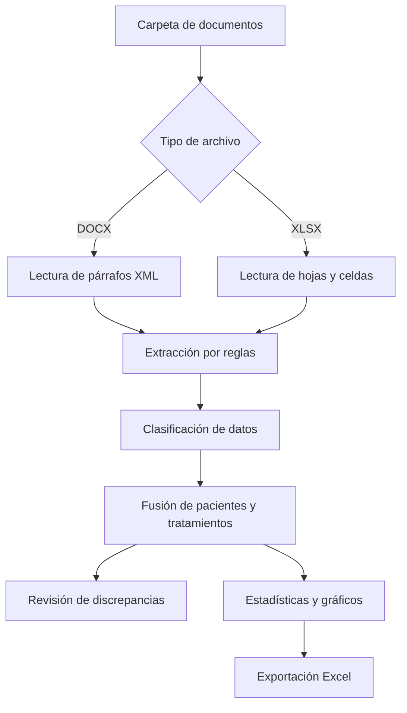
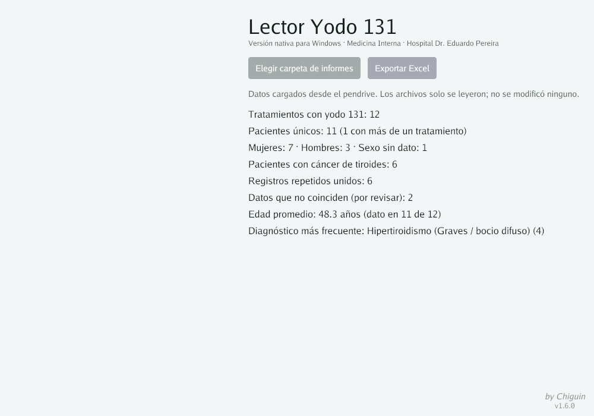

# Lector Yodo 131

**Procesamiento local de informes de yodoterapia y análisis estadístico de datos tiroideos**

**Autoría:** by Chiguin · **Plataformas:** navegador (versión completa) y Windows nativo (prototipo en desarrollo) · **Costo de operación local:** $0

> **Estado documentado:** este README se preparó a partir del paquete web **v1.5.0** y del informe de la etapa 1 del ejecutable **v1.6.0**. Antes de publicarlo, comprueba la versión real de la rama correspondiente; no debe cambiarse únicamente para actualizar la documentación.
>
> **Privacidad:** todas las capturas de este documento se generaron con **datos completamente ficticios**. No se incluyen datos clínicos reales de pacientes.



## Contenido

- [Presentación](#presentación)
- [Estado de las dos versiones](#estado-de-las-dos-versiones)
- [Capturas de pantalla](#capturas-de-pantalla)
- [Funciones principales](#funciones-principales)
- [Cómo se procesan los datos](#cómo-se-procesan-los-datos)
- [Fuentes y campos disponibles](#fuentes-y-campos-disponibles)
- [Pacientes, tratamientos y discrepancias](#pacientes-tratamientos-y-discrepancias)
- [Uso de la versión web](#uso-de-la-versión-web)
- [Versión nativa para Windows](#versión-nativa-para-windows)
- [Arquitectura del proyecto](#arquitectura-del-proyecto)
- [Privacidad y seguridad](#privacidad-y-seguridad)
- [Pruebas y control de calidad](#pruebas-y-control-de-calidad)
- [Limitaciones conocidas](#limitaciones-conocidas)
- [Versionado y colaboración](#versionado-y-colaboración)
- [Autoría y licencia](#autoría-y-licencia)

## Presentación

**Lector Yodo 131** es una aplicación desarrollada para organizar información procedente de informes de solicitud de yodoterapia en Word y de registros históricos en Excel, **sin transcripción manual**. Su objetivo es facilitar el análisis descriptivo de los casos registrados en el servicio clínico, incluidos edad, sexo, motivo de consulta, resultados de exámenes y frecuencia de cáncer de tiroides.

El proyecto nació de la necesidad de analizar documentación acumulada desde **2017**, con filtros por año, semestre o intervalo de meses. Los períodos pueden ajustarse sin alterar los archivos de origen.

La versión web está diseñada para funcionar desde un pendrive, sin instalar programas, o mediante un sitio web estático. El usuario selecciona los documentos desde su propio computador y el procesamiento se realiza en el navegador.

> **Alcance clínico:** es una herramienta de consolidación y estadística descriptiva. No establece diagnósticos, no reemplaza la revisión médica ni permite inferir incidencia poblacional a partir de un registro de atención.

## Estado de las dos versiones

| Característica | Web original | Windows nativo |
|---|---|---|
| Estado | **Aplicación funcional del paquete analizado** | **Prototipo de etapa 1** |
| Versión comprobable en los materiales recibidos | `v1.5.0` | `v1.6.0` según informe técnico |
| Tecnología | HTML, CSS y JavaScript | Go (motor) + Gio (interfaz) |
| Ejecutar sin internet | Sí, desde el pendrive | Sí, en el equipo, sujeto a prueba de compatibilidad |
| Leer `.docx` y `.xlsx` | Sí | Sí, según pruebas informadas |
| Clasificación, fusión y estadísticas | Sí | Sí, según pruebas diferenciales informadas |
| Gráficos clínicos y pestañas | Sí | **Pendiente de migración** |
| Tabla y apartado «Por revisar» | Sí | **Pendiente de migración visual** |
| Modo presentación | Sí | **Pendiente** |
| Exportación a Excel | Sí | Incluida en el prototipo |
| Uso mediante enlace | Posible con publicación estática | No corresponde al ejecutable |

**La versión web y el ejecutable no son equivalentes todavía.** El desarrollo nativo no reemplaza la web funcional y se mantiene separado mientras se completa la migración de la interfaz.

## Capturas de pantalla

Todas las imágenes siguientes corresponden a la **interfaz real** capturada con ejemplos ficticios; los números mostrados son demostrativos y no representan resultados clínicos.

### Panel principal y estadísticas


Vista de resumen con indicadores de pacientes únicos, tratamientos, sexo, edad, cáncer de tiroides y registros con discrepancias.



### Tabla de pacientes y tratamientos



Permite consultar y ordenar registros, revisar los resultados disponibles e identificar la procedencia de los datos.

### Información «Por revisar»



Los datos contradictorios, incompletos o no interpretados se presentan para revisión en vez de resolverse silenciosamente.

### Modo presentación



Enfocado en mostrar las cifras y los gráficos durante exposiciones, sin las tablas con nombres ni los controles de mantenimiento.

### Tema oscuro y diseño adaptable





Las pantallas se adaptan al tamaño disponible. Para cargas grandes de documentos se recomienda un computador.

## Funciones principales

| Área | Capacidades |
|---|---|
| **Carga de archivos** | Selección de carpeta, arrastrar y soltar, adición de otra carpeta y rechazo de archivos ya cargados en la misma sesión |
| **Word** | Lectura de `.docx`, incluidos varios informes dentro de un mismo archivo |
| **Excel histórico** | Lectura de planillas de yodoterapia `.xlsx` y hojas de registro tiroideo identificadas como `C73` |
| **Fusión** | Pacientes únicos, tratamientos diferentes, documentos repetidos y comparación entre fuentes |
| **Revisión** | Discrepancias entre fuentes, campos faltantes, documentos no reconocidos y origen de los registros |
| **Estadísticas** | Filtros de período y distribuciones por año, sexo, edad, motivo, diagnóstico, dosis, histología y exámenes |
| **Gráficos** | Visualizaciones de barras, proporciones, cifras y cobertura del dato |
| **Presentación** | Vista que oculta tablas nominales y controles internos, manteniendo gráficos y filtros |
| **Exportación** | Archivo `.xlsx` consolidado con información procesada |
| **Configuración** | Umbrales de determinados exámenes, en una sección de mantenimiento con protección por clave |
| **Interfaz** | Temas claro y oscuro, adaptación a pantallas más pequeñas y sello flotante de autor y versión |

### Indicadores clínicos incluidos

- Edad: promedio, mínima, máxima y distribución por tramos.
- Sexo: mujeres, hombres y casos sin información; origen registrado o inferido cuando corresponda.
- Número de tratamientos con yodo 131 y pacientes únicos por período.
- Motivos de consulta y diagnósticos.
- Cáncer de tiroides y tipos histológicos documentados, incluido carcinoma papilar cuando aparece en la fuente.
- Ecografía tiroidea: nódulos, adenopatías y clasificación **TIRADS** si está consignada.
- Punción aspirativa (**PAAF**) y clasificación **Bethesda** si está informada.
- Resultados disponibles de **TSH, T4L, T3, TRAb, tiroglobulina, anti-tiroglobulina y anti-TPO**.
- Registros de dosis, médico tratante y algunos antecedentes clínicos o hábitos cuando figuran en el documento.
- Cobertura de cada dato: cantidad con valor y cantidad **«Sin dato»**.

## Cómo se procesan los datos

La aplicación utiliza reglas de lectura y clasificación; **no emplea un servicio de inteligencia artificial ni envía el texto de los informes a un servidor** en el código del paquete web revisado.



**Lectura de Word.** Un archivo `.docx` contiene componentes XML comprimidos. El lector obtiene los párrafos de `word/document.xml`, identifica los informes mediante la etiqueta `NOMBRE:` y busca expresiones asociadas a los campos clínicos.

**Lectura de Excel.** El lector obtiene hojas y celdas desde el archivo `.xlsx` y reconoce formatos conocidos mediante encabezados como `PACIENTE`, `EDAD`, `DOSIS` o por filas de registro `C73`. Las hojas con estructuras no reconocidas se informan para revisión.

**Extracción por reglas.** El código busca etiquetas, patrones y sinónimos esperados; por ejemplo, TSH, TIRADS o Bethesda. Puede tolerar algunas variaciones de escritura, **pero no interpreta libremente cualquier documento**.

**Clasificación.** Los resultados se agrupan según el diagnóstico, motivo o categoría aplicable. Los valores no documentados deben mantenerse como faltantes; no se inventan.

**Estadísticas.** Los porcentajes de cada examen se calculan sobre los registros que **sí disponen de ese dato**, y se indica la cobertura respecto del universo correspondiente.

## Fuentes y campos disponibles

| Campo | Informes DOCX | Excel de yodo 131 | Registro C73 |
|---|---|---|---|
| Nombre, edad y fechas | Según informe | Según columnas | Según estructura disponible |
| RUT | Si está en el encabezado | Si figura en la hoja | Si figura en el registro |
| Sexo | Inferido cuando no está explícito | Cuando está informado | Cuando está informado |
| Médico y dosis | Según texto | Según columnas | Normalmente no incluye dosis |
| Diagnóstico | Según informe | Según hoja | Identificación de registro C73 |
| Motivo de consulta | Sí, si está escrito | Depende del formato | No habitual |
| TIRADS / ecografía | Sí, si está escrito | No habitual | No habitual |
| Bethesda / PAAF | Sí, si está escrito | No habitual | No habitual |
| Laboratorio y anticuerpos | Sí, si está escrito | No habitual | No habitual |
| Histología | Cuando figura en el informe | Depende del formato | No asumir subtipo histológico |
| Antecedentes y hábitos | Cuando figuran en el informe | Algunas planillas recientes | No habitual |

**No disponible no significa negativo.** En la vista clínica y en la exportación, un valor faltante debe distinguirse de un resultado normal o descartado.

## Pacientes, tratamientos y discrepancias

La aplicación diferencia tres conceptos:

| Concepto | Regla utilizada |
|---|---|
| **Paciente único** | Una persona identificada por RUT o, si falta, por nombre normalizado |
| **Tratamiento** | Un episodio de yodoterapia asociado a una persona y una fecha o período |
| **Registro repetido** | Distintas fuentes que parecen describir el mismo episodio |

El módulo `fusionTratamientos.js` incluye una **ventana de 60 días** para considerar compatibles dos fechas exactas del mismo paciente. Si una fecha tiene menor precisión, se usan reglas por mes o año. **Esta ventana es una heurística de software, no una validación clínica:** eventos realmente distintos pueden requerir revisión manual.

Al fusionar Word y Excel, se aprovechan los campos complementarios. Si dos fuentes entregan valores incompatibles para un mismo campo, se registra el conflicto y se deja pendiente de revisión; la aplicación no debe decidir silenciosamente cuál es el correcto.

**Ejemplo totalmente ficticio:** si un caso aparece en un Excel con fecha y dosis y en un informe Word con diagnóstico y resultados de exámenes, el sistema puede conservar las piezas compatibles sin duplicar el tratamiento. Si la dosis no coincide, debe quedar «Por revisar».

## Uso de la versión web

### Desde un pendrive, sin internet

1. Copia al pendrive el archivo `ABRIR LECTOR YODO 131.html`, el instructivo `LEEME - instrucciones.txt` y la carpeta completa `Sistema - no tocar`.
2. Abre **`ABRIR LECTOR YODO 131.html`** con Chrome o Edge actualizado.
3. Presiona **Elegir carpeta de informes** y selecciona los `.docx` y `.xlsx` que deseas analizar.
4. Revisa los gráficos, la tabla de pacientes y el apartado **Por revisar**.
5. Si necesitas incorporar otra carpeta en la misma sesión, usa **Agregar otra carpeta**.
6. Descarga el Excel consolidado mediante **Descargar Excel**.

**Importante:** los archivos nuevos **no se detectan automáticamente en segundo plano**. Debes seleccionarlos nuevamente o reiniciar la carga para incorporar cambios en la carpeta.

### Desde un enlace web

La interfaz también puede publicarse como **sitio estático** en un servicio como Cloudflare Pages. Los recursos HTML/CSS/JS se descargan al navegador; los documentos elegidos se procesan localmente por la implementación revisada.

**Estado del enlace público:** pendiente de confirmar en el despliegue actual. El enlace antiguo de GitHub Pages no debe darse por operativo después del cambio de visibilidad del repositorio.

> Un enlace compartido no equivale a control de acceso. Quien tenga acceso al sitio también puede inspeccionar el HTML, CSS y JavaScript entregados a su navegador. Si se requiere protección de la lógica comercial, utilizar la versión nativa o una arquitectura distinta.

### Requisitos y formatos

- Navegador actualizado con soporte de las APIs empleadas para descomprimir archivos Office; Chrome y Edge son las opciones recomendadas.
- Archivos Word **`.docx`** y planillas Excel **`.xlsx`**.
- Formatos antiguos **`.doc`** y **`.xls`**: no se procesan como formatos compatibles y deben convertirse antes a formatos modernos.
- No requiere Microsoft Word ni Excel instalados para leer los formatos compatibles.
- Los archivos de origen se leen; la aplicación no debe sobrescribirlos ni borrarlos.

## Versión nativa para Windows

Existe un **prototipo experimental** del lector para Windows, implementado con **Go + Gio**, sin navegador ni WebView. El objetivo es distribuir un `.exe` portable y hacer menos accesible la lógica de procesamiento que en JavaScript público.



**Implementado o reportado en la etapa 1:**

- Lectura y extracción desde DOCX/XLSX mediante el motor en Go.
- Clasificación, fusión de fuentes, indicadores de resumen y exportación a XLSX.
- Compilación de `Yodo131.exe` y pruebas automatizadas en GitHub Actions para Windows, según el informe técnico.
- Apertura de la aplicación en Windows y visualización de una interfaz básica.
- Sello `by Chiguin` con versión debajo.

**Pendiente antes de considerarlo equivalente a la web:**

- Reconstrucción de los gráficos clínicos, pestañas, tabla de pacientes, vista «Por revisar» y filtros completos.
- Modo presentación, diseño y adaptabilidad comparables con la versión web.
- Verificación visual, accesibilidad, controles, regresiones y pruebas funcionales más amplias en Windows.
- Validación de portabilidad y comportamiento en los equipos de destino, incluido el pendrive.

La rama de trabajo indicada en el informe es **`nativo-go`**, derivada de `develop`. **No se debe sustituir la versión web funcional por este prototipo** hasta completar y validar la migración.

## Arquitectura del proyecto

### Paquete web para pendrive

```text
Lector Yodo 131/
├── ABRIR LECTOR YODO 131.html
├── LEEME - instrucciones.txt
└── Sistema - no tocar/
    ├── index.html
    ├── css/
    │   └── estilos.css
    └── js/
        ├── app.js
        ├── version.js
        ├── lectorZip.js
        ├── lectorDocx.js
        ├── lectorXlsx.js
        ├── extractorInforme.js
        ├── extractorExcel.js
        ├── clasificador.js
        ├── fusionTratamientos.js
        ├── procesadorInformes.js
        ├── estadisticas.js
        ├── exportadorExcel.js
        ├── graficos.js
        ├── vistaResumen.js
        ├── tema.js
        ├── selloAutor.js
        ├── configuracion.js
        ├── seguridad.js
        └── registroErrores.js
```

### Responsabilidades principales

| Módulo | Función |
|---|---|
| `lectorZip.js` | Lee contenido comprimido de archivos Office |
| `lectorDocx.js` | Extrae párrafos del XML de Word |
| `lectorXlsx.js` | Extrae hojas y celdas de Excel |
| `extractorInforme.js` | Reconoce informes y campos clínicos en Word |
| `extractorExcel.js` | Reconoce tipos de planilla y extrae filas |
| `clasificador.js` | Clasifica diagnósticos, motivos, resultados y otros atributos |
| `fusionTratamientos.js` | Distingue pacientes, tratamientos, duplicados y conflictos |
| `procesadorInformes.js` | Coordina el procesamiento y la consolidación |
| `estadisticas.js` | Calcula indicadores y distribuciones |
| `graficos.js` y `vistaResumen.js` | Dibujan y organizan los gráficos |
| `exportadorExcel.js` | Construye el archivo XLSX descargable |
| `app.js` | Coordina el estado de la interfaz y sus eventos |
| `seguridad.js`, `configuracion.js` | Control de mantenimiento y umbrales |
| `registroErrores.js` | Registra errores técnicos |
| `selloAutor.js`, `version.js` | Firma flotante e identificación de versión |

El repositorio de desarrollo puede incluir además `ejemplos/`, `pruebas/`, `herramientas/` y flujos de GitHub Actions. Esos directorios **no forman parte del ZIP de distribución web revisado**.

## Privacidad y seguridad

- Los **informes reales no deben incluirse** en el repositorio, capturas, ejemplos ni pruebas.
- El lector web revisado procesa archivos seleccionados en el navegador; no se encontraron llamadas para subir los informes a una API en sus módulos JavaScript.
- **El sitio web y el repositorio son cosas distintas:** el repositorio privado puede ocultar el código no publicado, pero todo JavaScript entregado al visitante es inspeccionable.
- Los **umbrales de mantenimiento se conservan en `localStorage`** del navegador. El módulo de errores también persiste mensajes técnicos localmente. Estos registros deben revisarse para evitar la conservación accidental de identificadores personales en mensajes de error.
- La contraseña de mantenimiento no sustituye la autenticación de un sistema clínico ni controla quién puede inspeccionar el código web descargado.
- Evita usar almacenamiento compartido o no autorizado para los documentos clínicos; respeta los procedimientos institucionales de protección de datos.
- El modo presentación oculta controles y tabla nominal, pero **no anonimiza los datos de origen ni reemplaza controles de acceso**.

## Pruebas y control de calidad

El README original del repositorio describe pruebas automatizadas en **Node.js y Playwright** para extracción, fusión, porcentajes, interfaz y protección de firma. Estas pruebas deben ejecutarse en la versión real del repositorio; **no están incluidas en el ZIP de pendrive analizado**.

En una copia de desarrollo que contenga `package.json` y la carpeta de pruebas:

```bash
npm ci
npx playwright install chromium
npm test
```

También se documentan herramientas para regenerar ejemplos ficticios e inspeccionar la extracción por carpeta, si existen en la rama correspondiente.

### Comprobaciones prioritarias

- Un paciente con dos tratamientos en fechas distintas cuenta como **un paciente y dos tratamientos**.
- Word y Excel que describen el mismo evento no duplican resultados.
- Las contradicciones se muestran en **Por revisar**.
- Los porcentajes de exámenes usan denominadores con dato disponible e indican la cobertura.
- Las clasificaciones no confunden términos negativos, sospechas o antecedentes con diagnósticos confirmados.
- Ninguna captura ni conjunto de prueba contiene datos identificables de personas reales.
- El sello **`by Chiguin`** permanece visible, fijo en la esquina inferior derecha, con su versión real inmediatamente debajo; las pruebas deben fallar si se altera su texto, visibilidad o ubicación.
- El proceso de CI/compilación no publica datos clínicos ni incorpora credenciales.

### Evidencia de la etapa nativa

Según `INFORME_PROTOTIPO_NATIVO.md`, la etapa 1 informó comparaciones diferenciales entre Go y JavaScript, compilación Windows, exportación XLSX y generación de captura. **Ese alcance no equivale a validación visual de la migración completa**.

## Limitaciones conocidas

1. **Formato de los informes:** la lectura de Word se basa en etiquetas y estructuras esperadas. Documentos redactados de otra forma pueden requerir revisión.
2. **Duplicación:** el criterio de fechas cercanas puede fusionar eventos distintos o dejar separados registros del mismo tratamiento. Es indispensable validar casos dudosos.
3. **Sexo:** cuando se infiere a partir de nombre o datos gineco-obstétricos, el resultado es aproximado y debe distinguirse del sexo explícitamente registrado.
4. **Datos históricos:** las planillas antiguas no necesariamente contienen laboratorios, ecografía, PAAF o histología. Esos datos deben figurar como faltantes, no como normales.
5. **Umbrales de laboratorio:** los valores configurados son reglas de clasificación del software; deben ser revisados por la profesional responsable y no sustituyen el rango del laboratorio ni la valoración clínica.
6. **Privacidad del almacenamiento:** `localStorage` de errores/umbrales y cualquier dato exportado requieren revisión dentro del contexto institucional.
7. **Navegación web:** la carga del sitio puede necesitar internet; **la lectura de documentos se realiza localmente** una vez cargada la aplicación.
8. **Ejecutable nativo:** la interfaz Go + Gio está en etapa de prototipo, no en paridad funcional con la web.

## Versionado y colaboración

El proyecto utiliza la versión centralizada del programa, mostrada bajo la firma flotante **by Chiguin**. El archivo web de referencia contiene `VERSION_APLICACION = '1.5.0'`. El informe del prototipo nativo indica `1.6.0`. **Estos datos describen materiales distintos, no autorizan incrementos automáticos.**

Convención de versionado semántico:

- **Parche** (`x.y.Z`): correcciones compatibles.
- **Menor** (`x.Y.z`): nuevas funciones compatibles.
- **Mayor** (`X.y.z`): cambios incompatibles.

Antes de cada publicación deben coincidir las versiones relevantes, el historial de cambios y las etiquetas que correspondan. No se modifican historiales ni etiquetas existentes sin autorización.

### Ramas de trabajo

- `main`: versión estable/publicación, según el flujo real del repositorio.
- `develop`: integración del desarrollo.
- `nativo-go`: trabajo experimental de la migración nativa.

No mezclar cambios de la versión nativa con la web estable sin revisión y pruebas.

### Identidad Git obligatoria

Los commits deben utilizar **exclusivamente la identidad GitHub `JstChiguin (Chiguin)` y el correo verificado de su cuenta**. No se agregan autores ni coautores de sistemas de IA, líneas `Co-Authored-By` ni enlaces de sesiones. Verificar la identidad antes de cada commit.

## Autoría y licencia

**Desarrollado por Chiguin**, estudiante de Ingeniería en Informática.

**by Chiguin**

Este documento no agrega una licencia de código abierto ni autoriza la redistribución del código. Si el proyecto se comercializa, los términos de licencia de uso, entrega de ejecutable y acceso web deben definirse expresamente por separado.

---

**Nota de imágenes:** `docs/capturas/` contiene capturas de la aplicación web v1.5.0 ejecutada con documentos ficticios creados exclusivamente para documentación, además de una captura del prototipo Go/Gio procedente del artefacto de pruebas. No se utilizaron archivos reales de pacientes.
