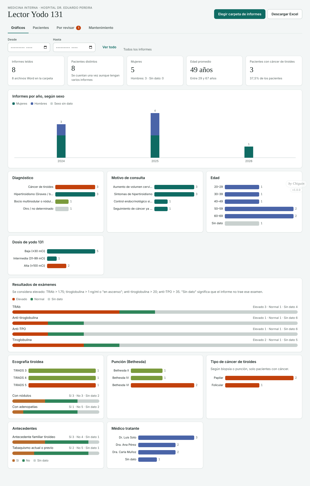
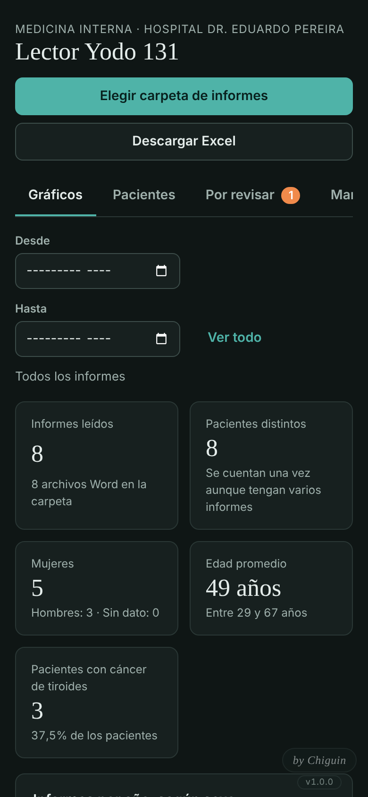

# Lector Yodo 131

[](https://github.com/JstChiguin/Yodo131/actions/workflows/pruebas.yml)

Herramienta **offline** que lee los informes de solicitud de yodoterapia (yodo 131) escritos en Word y las planillas Excel históricas, y los convierte en **gráficos y una planilla Excel consolidada**, sin que nadie tenga que transcribir datos.

Nació para resolver un problema real en un servicio de Medicina Interna: la endocrinóloga redacta un informe Word por paciente y necesitaba estadísticas (edad, sexo, motivo de consulta, resultados de exámenes, frecuencia de cáncer de tiroides) sin tener que llenar planillas. El programa vive en su pendrive, se abre con doble clic y se actualiza solo cada vez que se agregan informes.

> **Privacidad:** este repositorio no contiene datos de pacientes. Los informes y planillas de la carpeta `ejemplos/` y las capturas son ficticios.



## Qué hace

1. La usuaria elige la carpeta de informes (o la arrastra a la ventana). Puede contener informes Word y planillas Excel. Si están en carpetas distintas, usa «Agregar otra carpeta» y todo se analiza en conjunto; un archivo ya cargado no se cuenta dos veces.
2. El programa lee cada archivo:
   - **Informes Word (`.docx`):** un archivo puede traer varios informes;
   - **planilla de yodo 131 (`.xlsx`):** una hoja por año;
   - **registro de cáncer de tiroides C73 (`.xlsx`):** se reconoce por su contenido.
3. Agrupa los registros en pacientes y tratamientos, combina las fuentes y marca las discrepancias.
4. Muestra gráficos, una tabla de tratamientos y una lista de datos por revisar. Con un botón descarga el Excel consolidado.

### Pacientes, tratamientos y registros repetidos

| Concepto | Cómo se cuenta |
|---|---|
| **Paciente único** | Una persona cuenta una vez. Se identifica por RUT o, si falta, por nombre. |
| **Tratamiento** | Paciente + fecha. Una persona tratada en 2019 y en 2023 tiene dos tratamientos. |
| **Registro repetido** | Dos registros del mismo paciente con 60 días o menos de diferencia (por ejemplo, el Word y la fila del Excel, o dos filas del Excel) son el mismo tratamiento y cuentan una sola vez. |

### Combinación de fuentes sin decidir en silencio

Si el Word y el Excel describen el mismo tratamiento, se conserva lo que aporta cada uno; por ejemplo, la fecha del Excel y el diagnóstico y los exámenes del Word. Si se contradicen (dosis, edad, médico, diagnóstico, antecedentes o sexo), el programa **no elige**: el dato queda fuera de los gráficos y aparece en *Por revisar* con el valor y la ubicación de cada fuente. También avisa cuando un mismo RUT aparece con nombres distintos.

### Cobertura de cada dato

No es lo mismo un examen normal que un examen que nunca se registró. Cada gráfico indica la cobertura (por ejemplo: *"Dato disponible en 40 de 100 tratamientos (40%). Sin dato: 60 (60%)"*) y calcula los porcentajes solo sobre los que tienen el dato.

Datos que se obtienen:

| Grupo | Word | Excel yodo 131 | Registro C73 |
|---|---|---|---|
| Paciente: nombre, RUT, edad, fecha | ✅ | ✅ | ✅ |
| Sexo | deducido (con su origen) | ✅ (desde 2023) | ✅ |
| Médico y dosis | ✅ | ✅ | — |
| Diagnóstico | ✅ | solo algunas hojas | cáncer de tiroides |
| Motivo, ecografía (TIRADS), punción (Bethesda), tipo histológico | ✅ | — | — |
| TSH, T4L, T3, TRAb, tiroglobulina, anti-tiroglobulina, anti-TPO | ✅ | — | — |
| Antecedentes familiares, mórbidos, tabaco, alcohol, drogas | ✅ | ✅ (desde 2023) | — |

Cada gráfico explica qué muestra, destaca su conclusión principal e indica cantidad y porcentaje en cada barra. TIRADS y Bethesda muestran el significado de cada categoría. Al pasar el mouse por una barra aparece el detalle. Hay un botón para alternar entre modo claro y oscuro; el programa siempre abre en modo claro.

**Modo presentación:** para proyectar los gráficos en una exposición. Deja a la vista solo los gráficos, las cifras clínicas y el filtro de fechas. Oculta lo de uso interno (datos por revisar y su contador, discrepancias, origen de los datos, tabla con nombres de pacientes, mantenimiento y botones de carga). Al pasar el mouse, la tarjeta se eleva y en los gráficos la barra señalada se destaca mientras las demás se atenúan. «Salir de presentación» vuelve a la vista completa.

| Pacientes | Por revisar | Celular |
|---|---|---|
|  |  |  |

## Cómo funciona por dentro

- **Sin servidor, sin internet, sin instalación.** Es una página HTML que se abre desde el pendrive en Chrome o Edge. Los datos clínicos nunca salen del computador.
- **Sin librerías externas.** Un `.docx` es un zip: se lee su `word/document.xml` con `DecompressionStream`, nativo del navegador. El Excel se genera a mano en formato OOXML.
- **Extracción por reglas.** Los informes siguen una plantilla con etiquetas (`NOMBRE:`, `Ecotomografía tiroidea:`, `PAAF:`, `Ultima TSH:`, `Médico tratante:`…). El extractor busca esas etiquetas y tolera errores frecuentes de tipeo (`15O mC`, `Behesda`, fechas incompletas, plantillas con `-----`).
- **No inventa datos.** Si algo no está escrito en el informe queda como "Sin dato" y aparece en la pestaña *Por revisar*.
- **Solo lectura.** El programa nunca modifica ni borra los Word.
- **Mantenimiento con clave.** Los umbrales que definen un examen "elevado" se ajustan en una sección protegida. El código guarda solo la huella PBKDF2-SHA256 de la clave, nunca la clave.

### Decisiones y reglas principales

- **Página local en vez de ejecutable:** los computadores institucionales suelen bloquear programas `.exe` que se ejecutan desde un pendrive. Una página HTML se abre en cualquier navegador sin instalar nada.
- **Formato de los informes:** cada informe empieza con `NOMBRE:`, y un Word puede traer varios. El motivo de consulta es el texto libre que va entre `FECHA:` y la primera línea con etiqueta. La dosis sale de la frase "se decide administrar N mC".
- **Mismo tratamiento:** dos registros del mismo paciente con 60 días o menos de diferencia (constante `VENTANA_MISMO_TRATAMIENTO_DIAS` en `fusionTratamientos.js`). Si una fecha solo trae mes o año, se compara con esa precisión.
- **Diagnóstico:** se clasifica en este orden de prioridad: cáncer de tiroides → bocio multinodular o nódulo hiperfuncionante → hipertiroidismo → otro. Las líneas de mórbidos y de antecedentes familiares no se consideran, para que un cáncer de otro órgano no cuente como cáncer de tiroides.
- **Sexo:** el informe no lo trae. Se deduce de los datos gineco-obstétricos, luego del nombre y luego de palabras del texto; si no hay forma de saberlo, queda "Sin dato". La tabla muestra de dónde salió cada uno.
- **Médicos:** no hay una lista fija de nombres. El programa une las variantes del mismo nombre ("Dra. Pérez", "Dra Ana Pérez") con la forma más completa, y el título Dr./Dra. se decide por mayoría.
- **RUT:** se busca solo en el encabezado del informe, para no confundirlo con el RUT de la firma.
- **Umbrales de "elevado":** TRAb > 1,75; tiroglobulina > 1 ng/ml o "en ascenso"; anti-tiroglobulina > 20; anti-TPO > 35. Se ajustan en Mantenimiento y quedan guardados en el navegador de cada equipo.
- **Clave de mantenimiento:** el código guarda solo la sal y la huella PBKDF2-SHA256, con 310 000 iteraciones. Para cambiar la clave hay que generar una sal y una huella nuevas (por ejemplo con `hashlib.pbkdf2_hmac` de Python) y reemplazar las dos constantes en `seguridad.js`. La clave nunca se escribe en el repositorio.
- **Registro de errores:** guarda fecha, componente, método, tipo de error, mensaje y versión, en memoria y en el navegador. No guarda nombres de archivo ni datos de pacientes.

### Arquitectura

```
ABRIR LECTOR YODO 131.html      acceso directo que abre la aplicación
Sistema - no tocar/
  index.html                     estructura de la interfaz
  css/estilos.css                estilos (tema claro y oscuro, responsive)
  js/
    version.js                   versión de la aplicación (única fuente)
    lectorZip.js                 acceso a datos: lectura de archivos zip (Word y Excel son zip)
    lectorDocx.js                Word → párrafos
    lectorXlsx.js                Excel → hojas y celdas (textos, números, fechas)
    extractorInforme.js          divide informes Word y extrae campos
    extractorExcel.js            reconoce planillas de yodo y registro C73 y extrae sus filas
    clasificador.js              reglas: diagnóstico, motivo, umbrales, sexo, médicos
    fusionTratamientos.js        pacientes únicos, tratamientos, registros repetidos y discrepancias
    procesadorInformes.js        orquesta lectura → extracción → clasificación → fusión
    estadisticas.js              conteos y filtro por período
    exportadorExcel.js           genera el .xlsx
    configuracion.js             umbrales guardados en el navegador
    seguridad.js                 verificación de la clave de mantenimiento
    registroErrores.js           registro centralizado de errores
    graficos.js                  componentes de gráficos (barras, proporciones, detalle al pasar el mouse)
    vistaResumen.js              arma la pestaña Gráficos: conclusiones, colores y significado de TIRADS/Bethesda
    tema.js                      modo claro / oscuro
    selloAutor.js                firma «by Chiguin» y versión, fijas en pantalla
    app.js                       interfaz y eventos
ejemplos/                        informes Word y planillas Excel ficticios para probar
herramientas/generarEjemplos.py  genera esos ejemplos (python-docx y openpyxl)
pruebas/                         pruebas automáticas (Node)
```

## Uso

**En línea, sin instalar nada:** https://jstchiguin.github.io/Yodo131/

El programa se descarga desde GitHub Pages, pero los archivos que se eligen se leen en el navegador del propio computador: no se suben a ningún servidor. Requiere internet solo para abrir la página.

**Desde un pendrive, sin internet:**

1. Descargar el repositorio y copiar al pendrive `ABRIR LECTOR YODO 131.html`, `LEEME - instrucciones.txt` y la carpeta `Sistema - no tocar`.
2. Abrir `ABRIR LECTOR YODO 131.html` con Chrome o Edge.
3. Elegir la carpeta de informes. Para probar sin datos reales, elegir la carpeta `ejemplos/`.

Requisitos: Chrome o Edge actualizados (Firefox 113 o superior también sirve). Los Word antiguos (`.doc`) deben guardarse como `.docx`.

## Pruebas

```bash
npm ci                                       # instala Playwright (solo para pruebas)
npx playwright install chromium              # navegador para las pruebas
npm test                                     # todas las pruebas
node pruebas/revisarCarpeta.mjs ejemplos     # muestra lo que se extrae de cada informe
python3 herramientas/generarEjemplos.py      # regenera los ejemplos (requiere python-docx y openpyxl)
```

Qué se prueba:

- **Extracción:** reglas de lectura con informes ficticios (datos, laboratorio, errores de tipeo, varios informes en un Word, plantillas incompletas, unificación de médicos).
- **Fusión y cobertura:** con los ejemplos ficticios verifica que:
  - un paciente tratado dos veces cuente como dos tratamientos;
  - los registros repetidos no sumen;
  - Word y Excel se combinen;
  - las discrepancias queden por revisar;
  - el cáncer se cuente por paciente;
  - los porcentajes usen solo los datos disponibles.
- **Integridad de la firma:** abre la aplicación en Chromium en escritorio, tablet y celular, en modo claro y oscuro, recorre todas las pestañas y el modo presentación, y comprueba que:
  - el texto sea exactamente `by Chiguin`;
  - la versión real aparezca centrada debajo;
  - la firma esté visible, flotante y en la esquina inferior derecha, sin nada encima.

  Si alguien modifica, elimina, reemplaza, oculta o mueve la firma, la prueba falla con un mensaje del tipo `FIRMA DE AUTOR ALTERADA (...)`. Esta comprobación solo corre en las pruebas: nunca bloquea la aplicación para quien la usa.
- **Modo presentación:** comprueba que oculte todo lo de uso interno, que los gráficos sigan visibles, que tarjetas y barras se resalten al pasar el mouse y que al salir vuelva todo.
- **Versión:** sigue versionamiento semántico, coincide en `package.json` y `version.js`, y tiene su entrada en el CHANGELOG.

Las pruebas corren automáticamente en GitHub Actions en cada push y pull request (`.github/workflows/pruebas.yml`).

## Versiones

La versión se muestra bajo la firma, en la esquina inferior derecha, y en la hoja *Resumen* del Excel. Se usa [versionado semántico](https://semver.org/lang/es/):

- **parche** (`1.0.1`): corrección de un error de lectura;
- **menor** (`1.1.0`): nuevo campo, gráfico o función;
- **mayor** (`2.0.0`): cambio que obliga a cambiar la forma de usarlo.

Para publicar una versión nueva:

1. cambiar el número en `Sistema - no tocar/js/version.js` y en `package.json`;
2. anotar el cambio en `CHANGELOG.md`;
3. `git commit`, luego `git tag v1.1.0` y `git push --follow-tags`.

El historial está en [CHANGELOG.md](CHANGELOG.md).

## Tecnologías

HTML · CSS · JavaScript (sin dependencias) · Node.js para pruebas · Python para generar ejemplos. Costo de operación: $0.

## Autoría

Desarrollado por **Chiguin**, estudiante de Ingeniería en Informática.

*by Chiguin*
