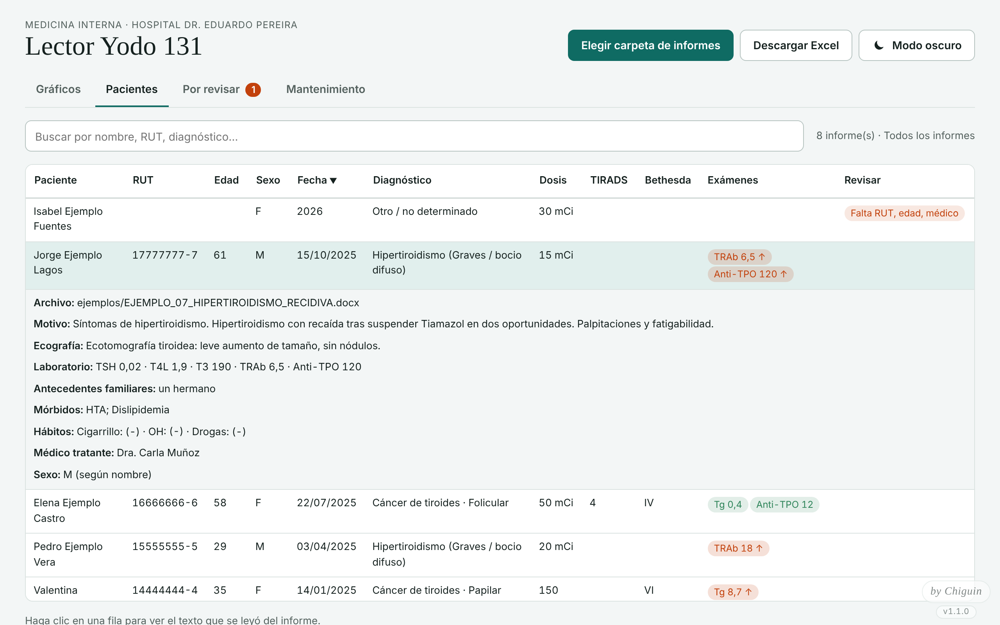
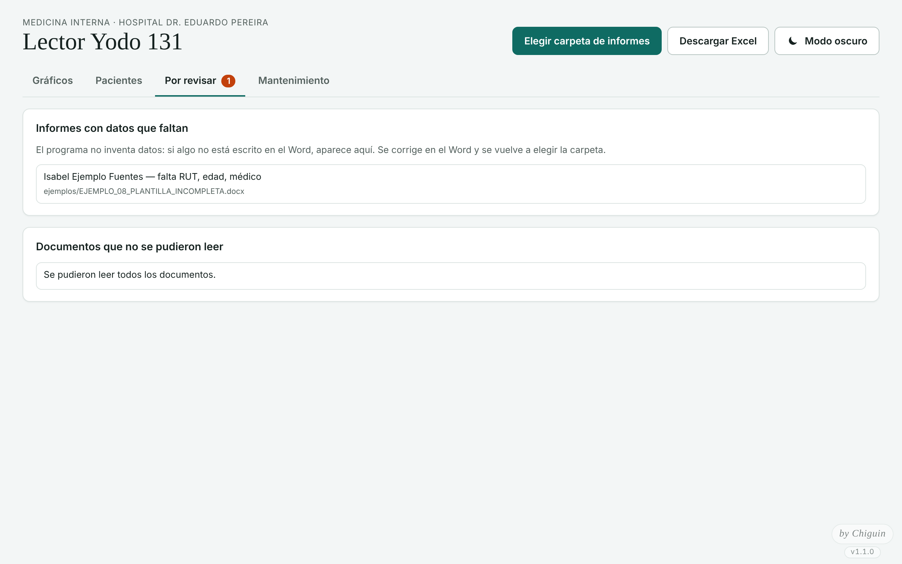

# Lector Yodo 131

Herramienta **offline** que lee los informes de solicitud de yodoterapia (yodo 131) escritos en Word y los convierte en **gráficos y una planilla Excel**, sin que nadie tenga que transcribir datos.

Nació para resolver un problema real en un servicio de Medicina Interna: la endocrinóloga redacta un informe Word por paciente y necesitaba estadísticas (edad, sexo, motivo de consulta, resultados de exámenes, frecuencia de cáncer de tiroides) sin tener que llenar planillas. El programa vive en su pendrive, se abre con doble clic y se actualiza solo cada vez que se agregan informes.

> **Privacidad:** este repositorio no contiene datos de pacientes. Los informes de la carpeta `ejemplos/` y las capturas son ficticios.


## Qué hace

1. La usuaria elige la carpeta de informes (o la arrastra a la ventana).
2. El programa abre cada `.docx`, encuentra los informes (un Word puede traer varios) y extrae los datos del texto.
3. Muestra gráficos, una tabla de pacientes y una lista de datos por revisar; con un botón descarga el Excel.

Cada gráfico explica qué muestra, destaca su conclusión principal (por ejemplo, el diagnóstico más frecuente y su porcentaje) e indica cantidad y porcentaje en cada barra. TIRADS y Bethesda muestran el significado de cada categoría. Al pasar el mouse por una barra aparece el detalle. Hay un botón para alternar entre modo claro y oscuro; el programa siempre abre en modo claro.

Datos que obtiene de cada informe:

| Grupo | Campos |
|---|---|
| Paciente | nombre, RUT, edad, sexo (inferido, con su origen), fecha |
| Consulta | motivo (texto y categoría), médico tratante, dosis de yodo 131, rechazo del tratamiento |
| Diagnóstico | cáncer de tiroides / hipertiroidismo / bocio multinodular, tipo histológico, estadificación y riesgo |
| Imágenes | ecografía (TIRADS, nódulos, adenopatías), cintigrama |
| Punción | resultado y categoría Bethesda |
| Laboratorio | TSH, T4L, T3, TRAb, tiroglobulina, anti-tiroglobulina, anti-TPO, con estado normal / elevado |
| Antecedentes | familiares tiroideos, mórbidos, tabaco, alcohol, drogas |

| Pacientes | Por revisar | Celular |
|---|---|---|
|  |  |  |

## Cómo funciona por dentro

- **Sin servidor, sin internet, sin instalación.** Es una página HTML que se abre desde el pendrive en Chrome o Edge. Los datos clínicos nunca salen del computador.
- **Sin librerías externas.** Un `.docx` es un zip: se lee su `word/document.xml` con `DecompressionStream`, nativo del navegador. El Excel se genera a mano en formato OOXML.
- **Extracción por reglas.** Los informes siguen una plantilla con etiquetas (`NOMBRE:`, `Ecotomografía tiroidea:`, `PAAF:`, `Ultima TSH:`, `Médico tratante:`…). El extractor busca esas etiquetas y tolera errores frecuentes de tipeo (`15O mC`, `Behesda`, fechas incompletas, plantillas con `-----`).
- **No inventa datos.** Si algo no está escrito en el informe queda como "Sin dato" y aparece en la pestaña *Por revisar*.
- **Solo lectura.** El programa nunca modifica ni borra los Word.
- **Mantenimiento con clave.** Los umbrales que definen un examen "elevado" se ajustan en una sección protegida. El código guarda solo la huella PBKDF2-SHA256 de la clave, nunca la clave.

### Decisiones y reglas principales

- **Página local en vez de ejecutable:** los computadores institucionales suelen bloquear programas `.exe` que se ejecutan desde un pendrive. Una página HTML se abre en cualquier navegador sin instalar nada.
- **Formato de los informes:** cada informe empieza con `NOMBRE:`, y un Word puede traer varios. El motivo de consulta es el texto libre que va entre `FECHA:` y la primera línea con etiqueta. La dosis sale de la frase "se decide administrar N mC".
- **Diagnóstico:** se clasifica en este orden de prioridad: cáncer de tiroides → bocio multinodular o nódulo hiperfuncionante → hipertiroidismo → otro. Las líneas de mórbidos y de antecedentes familiares no se consideran, para que un cáncer de otro órgano no cuente como cáncer de tiroides.
- **Sexo:** el informe no lo trae. Se deduce de los datos gineco-obstétricos, luego del nombre y luego de palabras del texto; si no hay forma de saberlo, queda "Sin dato". La tabla muestra de dónde salió cada uno.
- **Médicos:** no hay una lista fija de nombres. El programa une las variantes del mismo nombre ("Dra. Pérez", "Dra Ana Pérez") con la forma más completa, y el título Dr./Dra. se decide por mayoría.
- **RUT:** se busca solo en el encabezado del informe, para no confundirlo con el RUT de la firma.
- **Umbrales de "elevado":** TRAb > 1,75; tiroglobulina > 1 ng/ml o "en ascenso"; anti-tiroglobulina > 20; anti-TPO > 35. Se ajustan en Mantenimiento y quedan guardados en el navegador de cada equipo.
- **Clave de mantenimiento:** el código guarda solo la sal y la huella PBKDF2-SHA256, con 310 000 iteraciones. Para cambiar la clave hay que generar una sal y una huella nuevas (por ejemplo con `hashlib.pbkdf2_hmac` de Python) y reemplazar las dos constantes en `seguridad.js`. La clave nunca se escribe en el repositorio.
- **Registro de errores:** guarda fecha, componente, método, tipo de error, mensaje y versión, en memoria y en el navegador. No guarda nombres de archivo ni datos de pacientes.

### Arquitectura

```
ABRIR LECTOR YODO 131.html      acceso directo que abre la aplicación
Sistema - no tocar/
  index.html                     estructura de la interfaz
  css/estilos.css                estilos (tema claro y oscuro, responsive)
  js/
    version.js                   versión de la aplicación (única fuente)
    lectorDocx.js                acceso a datos: zip → document.xml → párrafos
    extractorInforme.js          divide informes y extrae campos
    clasificador.js              reglas: diagnóstico, motivo, umbrales, sexo, médicos
    procesadorInformes.js        orquesta lectura → extracción → clasificación
    estadisticas.js              conteos y filtro por período
    exportadorExcel.js           genera el .xlsx
    configuracion.js             umbrales guardados en el navegador
    seguridad.js                 verificación de la clave de mantenimiento
    registroErrores.js           registro centralizado de errores
    graficos.js                  componentes de gráficos (barras, proporciones, detalle al pasar el mouse)
    vistaResumen.js              arma la pestaña Gráficos: conclusiones, colores y significado de TIRADS/Bethesda
    tema.js                      modo claro / oscuro
    selloAutor.js                firma «by Chiguin» y versión, fijas en pantalla
    app.js                       interfaz y eventos
ejemplos/                        informes ficticios para probar
herramientas/generarEjemplos.py  genera esos informes
pruebas/                         pruebas automáticas (Node)
```

## Uso

1. Descargar el repositorio y copiar al pendrive `ABRIR LECTOR YODO 131.html`, `LEEME - instrucciones.txt` y la carpeta `Sistema - no tocar`.
2. Abrir `ABRIR LECTOR YODO 131.html` con Chrome o Edge.
3. Elegir la carpeta de informes. Para probar sin datos reales, elegir la carpeta `ejemplos/`.

Requisitos: Chrome o Edge actualizados (Firefox 113 o superior también sirve). Los Word antiguos (`.doc`) deben guardarse como `.docx`.

## Pruebas

```bash
node --test pruebas/*.test.mjs                # reglas de extracción y presencia del sello
node pruebas/revisarCarpeta.mjs ejemplos      # muestra lo que se extrae de cada informe
python3 herramientas/generarEjemplos.py       # regenera los informes de ejemplo (requiere python-docx)
```

## Versiones

La versión se muestra bajo la firma, en la esquina inferior derecha, y en la hoja *Resumen* del Excel. Se usa [versionado semántico](https://semver.org/lang/es/):

- **parche** (`1.0.1`): corrección de un error de lectura;
- **menor** (`1.1.0`): nuevo campo, gráfico o función;
- **mayor** (`2.0.0`): cambio que obliga a cambiar la forma de usarlo.

Para publicar una versión nueva:

1. cambiar el número en `Sistema - no tocar/js/version.js`;
2. anotar el cambio en `CHANGELOG.md`;
3. `git commit`, luego `git tag v1.1.0` y `git push --follow-tags`.

El historial está en [CHANGELOG.md](CHANGELOG.md).

## Tecnologías

HTML · CSS · JavaScript (sin dependencias) · Node.js para pruebas · Python para generar ejemplos. Costo de operación: $0.

## Autoría

Desarrollado por **Chiguin**, estudiante de Ingeniería en Informática.

*by Chiguin*
